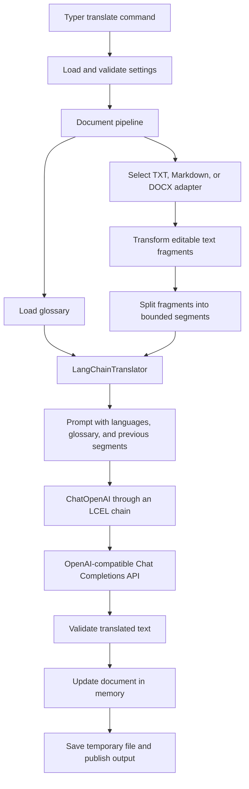

# Project architecture

The application translates technical documents using a configurable
OpenAI-compatible API. It runs synchronously as a Python CLI: documents are loaded
into memory, translated in sequence, and saved after all segments succeed.
Python dependencies and the `tech-translator` entry point are declared in
`pyproject.toml`; `uv.lock` records resolved dependency versions.

## Components and responsibilities

```text
llm_translator/
├── configs/default.yaml          # Example connection and translation settings
├── glossaries/en_ru.yaml         # Preferred translations for technical terms
├── input/                       # Source documents; data ignored by Git
├── output/                      # Translated documents; data ignored by Git
├── src/tech_translator/
│   ├── cli.py                   # Typer commands, reports, exit codes
│   ├── config.py                # Validated settings and configuration loading
│   ├── llm/
│   │   ├── client.py            # Shared ChatOpenAI construction
│   │   ├── prompts.py           # Translation instructions and prompt template
│   │   ├── translator.py        # Segment translation and response validation
│   │   └── api_health.py        # Independent API diagnostics
│   ├── core/
│   │   ├── pipeline.py          # Complete document translation workflow
│   │   ├── segmenter.py         # Bounded splitting without losing characters
│   │   └── glossary.py          # Safe YAML loading and glossary validation
│   ├── parsers/
│   │   ├── __init__.py          # Document selection by filename extension
│   │   ├── text.py              # TXT and Markdown document adapters
│   │   └── docx.py              # DOCX document adapter
│   ├── exporters/atomic.py      # Complete-file publication and overwrite rules
│   └── utils/
│       ├── errors.py            # API diagnostics and text response extraction
│       └── logging.py           # Application logger setup
└── tests/                       # Offline unit tests and opt-in live API test
```

`input/` and `output/` are conventions used by the examples. The CLI accepts other
paths and does not automatically scan these folders or process them in batches.

## Translation flow



1. The CLI loads settings and calls `translate_document()`.
2. The pipeline rejects identical input/output paths, incompatible formats, and
   an existing output unless `--force` is supplied.
3. The selected document adapter loads the document. The glossary loader reads a
   mapping of nonempty source terms to nonempty preferred translations.
4. The adapter calls the pipeline's translation callback for editable fragments.
   The callback splits long fragments, preserves surrounding whitespace, and
   leaves fragments without letters unchanged.
5. Each segment is translated with the glossary and up to two previous
   source/translation pairs. History belongs to one document translation run.
6. The adapter updates the document in memory. Once every fragment succeeds, the
   exporter publishes the complete output file.

The pipeline owns document history and segmentation. The translator accepts a
single segment plus optional context and glossary; it does not open or save files.

## Configuration and API client

`config.py` uses Pydantic models for connection, translation, and logging settings,
and `pydantic-settings` for environment overrides. Precedence is:

```text
--model override > environment variables > explicit YAML file > built-in defaults
```

Only the model has a dedicated CLI setting override. Nested environment variables
use `__`, for example `LLM__BASE_URL`, `LLM__TIMEOUT`, and
`TRANSLATION__TARGET_LANGUAGE`. `--config` selects a YAML file; without it the
application uses built-in defaults rather than automatically reading
`configs/default.yaml`. Relative glossary paths are resolved against the selected
configuration file's directory.

`LLM_API_KEY` supplies the API credential, stored as `SecretStr`. YAML credentials
are rejected. If the variable is absent, the placeholder `local` is used. The
default endpoint is `http://localhost:1234/v1`. URL validation rejects embedded
credentials, query parameters, and fragments.

`llm/client.py` creates `ChatOpenAI` from the shared settings, including timeout,
retry count, temperature, output token limit, model, and base URL.
`use_responses_api=False` selects Chat Completions. Both translation and API
diagnostics use this factory. Model listing uses a separate `httpx` client with
the same base URL, API key, and timeout.

## Prompts, validation, and fallback

`prompts.py` defines a `ChatPromptTemplate` containing a system instruction and a
human message template. The human message carries the languages, glossary,
previous segments, and current text. The prompt instructs the model to treat
document content as data and return only the translation.

`LangChainTranslator` composes the prompt and model with LCEL's `|` operator.
`TranslationResult` validates that the returned translation is a nonempty string.
The configured `structured_output` mode controls the response path:

| Mode | Behavior |
| --- | --- |
| `auto` | Try a Pydantic schema through JSON schema output; use plain text after supported capability/parsing failures. |
| `on` | Require structured output and propagate failures. |
| `off` | Request plain text directly. |

In auto mode, a structured-output `BadRequestError` triggers fallback only when
its message mentions `response_format`, `json_schema`, or `structured`. Unsupported
operations and schema/parsing validation errors can also trigger fallback. After
fallback, that translator instance uses plain text for subsequent segments.
Authentication failures, rate limits, and server outages are not fallback triggers;
the client's configured retry behavior still applies.

The plain-text path accepts string content or text blocks, rejects empty results,
and rejects responses reporting `finish_reason="length"`. Validation does not
prove translation accuracy or enforce glossary usage mechanically.

The pipeline and translator estimate input token usage from UTF-8 byte length,
reserve `max_tokens` plus a 256-unit margin, and account for prompt/glossary size.
The segmenter applies both character and byte limits. The translator trims older
context until the prompt fits. This is a conservative heuristic rather than a
model-specific tokenizer or a guarantee about every server's accounting.

## Document adapters and output

Adapters follow a small shared interface: construct from a path,
`transform(translate_callback)`, and `save(path)`.

| Format | Editable unit and preservation strategy |
| --- | --- |
| TXT | Translate individual lines; preserve line endings, blank lines, and a UTF-8 BOM. |
| Markdown | Use `markdown-it-py` block locations and source-span protection; translate prose fragments while retaining common markup, code, link targets, references, front matter, and HTML blocks. |
| DOCX | Update Word XML text nodes in exposed document parts, including body, tables, headers, and footers; retain surrounding XML, formatting, links, and images. |

Markdown is edited in its original source rather than rendered and regenerated.
HTML blocks remain untranslated. Inline Markdown handling uses regular expressions,
so unusual or complex syntax may need additional handling. DOCX paragraphs or runs
whose explicit style identifiers contain `code` are skipped. Other DOCX text is
translated node by node; formatting boundaries can therefore split sentences and
reduce fluency. Embedded documents and text inside images are not translated.

`exporters/atomic.py` writes a temporary file in the output directory. With
`--force`, it publishes with `os.replace`; otherwise, it uses `os.link` to create
the destination only if it does not already exist. The temporary file is removed
afterward. This prevents partial output from being published and protects against
a concurrent writer creating the destination. Publication without `--force`
requires filesystem hard-link support. A translation failure leaves an existing
output untouched.

## Independent API diagnostics

`test-api` calls `check_api()` directly and does not load document parsers, segment
documents, or apply the translation glossary.

1. Request `<base_url>/models` and, when a valid listing is returned, check the
   configured model identifier.
2. Send a short English-to-Russian generation request through `ChatOpenAI`, using
   `SystemMessage` and `HumanMessage`.
3. Extract nonempty text, record generation time, and return `APIHealthResult`.

The result contains `connected`, `model_available`, `generation_success`,
`response_time_ms`, `test_response`, and `error`. `model_available=None` means the
listing could not be checked; `False` means a valid listing omitted the model.
Listing is advisory: generation runs even when listing fails or omits the model,
and successful generation determines overall success. Generation timing excludes
the listing request and includes client construction and any generation retries.

The CLI renders either a readable report or JSON (`--json`) and exits with code 1
on a failed check. Shared diagnostics cover connection errors, timeouts,
authentication/authorization errors, missing endpoints/models, rate limits, and
common server errors. Remote exception bodies and HTTP headers are not included
in those diagnostic messages.

## Tests and extension points

| Test file | Coverage |
| --- | --- |
| `test_config_client.py` | Settings precedence, secret handling, client configuration, and real LangChain routing through mocked HTTP. |
| `test_translator.py` | Structured and plain responses, context/glossary injection, fallback, and empty output rejection. |
| `test_api_health.py` | Diagnostic results, connection/HTTP failures, unsupported model listing, CLI output, and an opt-in live API check. |
| `test_documents.py` | Segmentation, whitespace, Markdown/DOCX preservation, glossary/context propagation, and output protection. |

Run offline tests with `uv run pytest -m 'not integration'`. The live check requires
`RUN_LLM_INTEGRATION=1 uv run pytest -m integration`; optionally set `LLM_CONFIG`
to select its YAML configuration file. Dependencies can be injected through the
translator's `llm` parameter, the health check's `llm`/`http_client` parameters,
and the pipeline's `translator` parameter, keeping tests independent of a server.

To add a format, implement the adapter interface and register its extension in
`parsers/__init__.py`. To change prompts, edit `llm/prompts.py`. To support additional
OpenAI-compatible servers, start with configuration and the shared client factory.
There is currently no asynchronous scheduling, resumable job state, translation
cache, or database; adding those would require extending the sequential pipeline.
